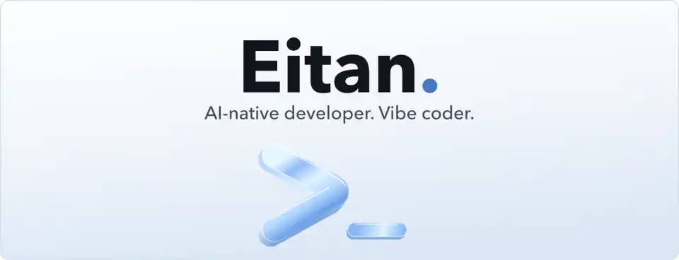

<p align="center">
  <picture>
    <source media="(prefers-color-scheme: dark)" srcset="./assets/banners/profile-dark.webp">
    <source media="(prefers-color-scheme: light)" srcset="./assets/banners/profile-light.webp">
    
  </picture>
</p>

<p align="center">
  <strong>AI writes the first draft. I decide what ships.</strong>
</p>

<p align="center">
  I build software with coding agents.<br>
  Every new model gets the same benchmark: the bug I couldn't fix last week.
</p>

<p align="center">
  <picture>
    <source media="(prefers-color-scheme: dark)" srcset="./assets/badges/codex-dark.webp">
    <source media="(prefers-color-scheme: light)" srcset="./assets/badges/codex.webp">
    
  </picture>
  <picture>
    <source media="(prefers-color-scheme: dark)" srcset="./assets/badges/claude-code-dark.webp">
    <source media="(prefers-color-scheme: light)" srcset="./assets/badges/claude-code.webp">
    
  </picture>
  <picture>
    <source media="(prefers-color-scheme: dark)" srcset="./assets/badges/gemini-cli-dark.webp">
    <source media="(prefers-color-scheme: light)" srcset="./assets/badges/gemini-cli.webp">
    
  </picture>
</p>

**All tests pass. Technically.**

```console
$ agent "fix the bug"
  All tests pass.

$ git diff --name-only
  tests/test_checkout.py

$ git status --short
  ?? trust_issues
```

<p align="center">
  <a href="https://eitanwong.github.io">
    <picture>
      <source media="(prefers-color-scheme: dark)" srcset="./assets/badges/blog-dark.webp">
      <source media="(prefers-color-scheme: light)" srcset="./assets/badges/blog.webp">
      
    </picture>
  </a>
  <a href="https://space.bilibili.com/29687975">
    <picture>
      <source media="(prefers-color-scheme: dark)" srcset="./assets/badges/bilibili-dark.webp">
      <source media="(prefers-color-scheme: light)" srcset="./assets/badges/bilibili.webp">
      
    </picture>
  </a>
  <a href="https://linux.do/u/eitan/summary">
    <picture>
      <source media="(prefers-color-scheme: dark)" srcset="./assets/badges/linux-do-dark.webp">
      <source media="(prefers-color-scheme: light)" srcset="./assets/badges/linux-do.webp">
      
    </picture>
  </a>
  <a href="mailto:unease-equity-5c@icloud.com">
    <picture>
      <source media="(prefers-color-scheme: dark)" srcset="./assets/badges/email-dark.webp">
      <source media="(prefers-color-scheme: light)" srcset="./assets/badges/email.webp">
      
    </picture>
  </a>
</p>
